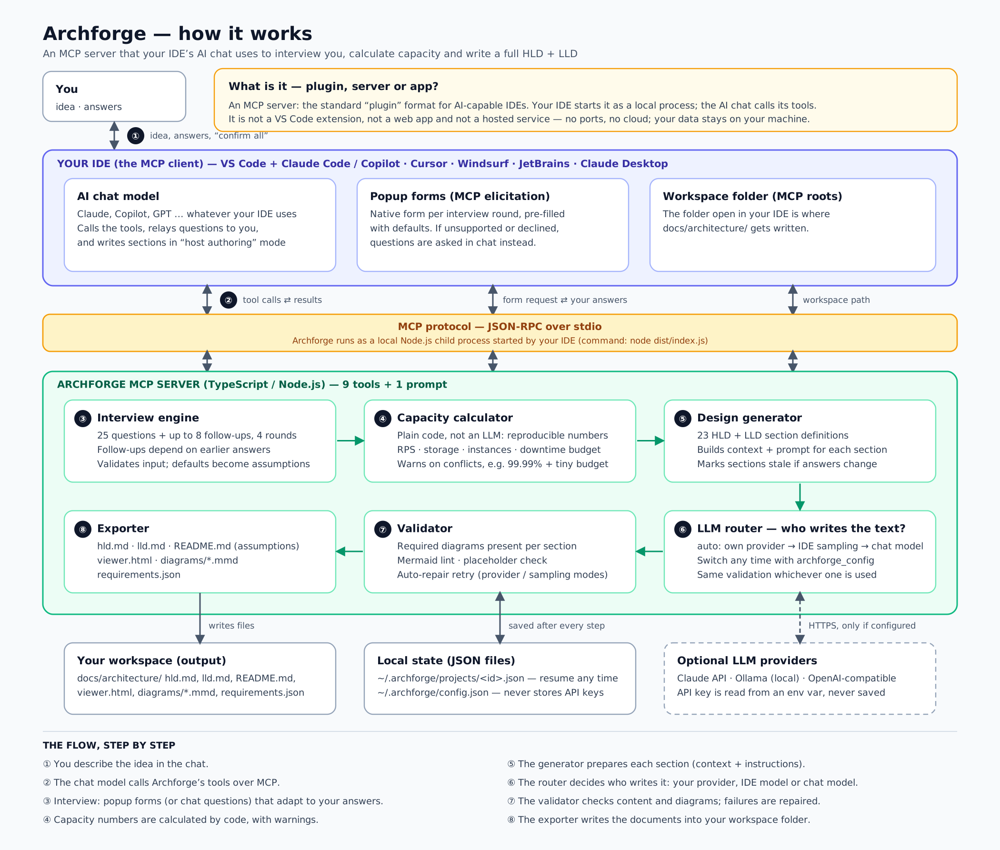

# Archforge MCP

**Describe an application in your IDE's AI chat. Archforge interviews you, calculates capacity, and writes a complete High-Level Design (HLD) and Low-Level Design (LLD) with diagrams — a blueprint you can build the app from.**

Archforge is an **MCP server**: a small local Node.js program that AI-capable IDEs (VS Code, Claude Code, Cursor, Windsurf, JetBrains, Claude Desktop, …) start in the background and whose tools the AI chat can call. It is not a web app, not a hosted service and not an IDE-specific extension.



*(Editable vector version: [`docs/images/archforge-architecture.svg`](docs/images/archforge-architecture.svg))*

---

## Contents

1. [What you get](#what-you-get)
2. [Requirements](#requirements)
3. [Quick start](#quick-start)
4. [Using it day to day](#using-it-day-to-day)
5. [How it works](#how-it-works)
6. [Who writes the documents? (LLM options)](#who-writes-the-documents-llm-options)
7. [How the questions are shown](#how-the-questions-are-shown)
8. [Tools reference](#tools-reference)
9. [Output files](#output-files)
10. [Configuration](#configuration)
11. [Troubleshooting](#troubleshooting)
12. [Security and privacy](#security-and-privacy)
13. [Limitations](#limitations)
14. [Customizing](#customizing)
15. [Development](#development)
16. [FAQ](#faq)

More detail lives in [`docs/`](docs): [ARCHITECTURE](docs/ARCHITECTURE.md) · [CONFIGURATION](docs/CONFIGURATION.md) · [TROUBLESHOOTING](docs/TROUBLESHOOTING.md) · [QUESTIONS](docs/QUESTIONS.md) · [SECTIONS](docs/SECTIONS.md)

---

## What you get

* **An adaptive requirements interview** — 33 questions in 4 rounds (product → scale → platform → security). 25 are always asked; 8 are follow-ups that appear only when your answers call for them (payments → card-data handling, B2B → tenancy model, real-time → connection counts, uploads → storage size, high availability → disaster-recovery level, data residency → regions, …).
* **Capacity numbers calculated by code, not by an LLM** — design RPS, read/write RPS, storage, instance counts, allowed downtime, plus consistency warnings such as "99.99% availability on a $500 budget".
* **23 written sections** (12 HLD + 11 LLD): architecture style, components, data architecture, key flows, cloud mapping, scaling & DR, security, operations, project structure, ER diagram, API design, class design, sequence diagrams, state machines, async/events, caching & consistency, validation & RBAC, testing & deployment, and an ordered **build plan**.
* **Diagrams** in Mermaid (flowcharts, sequence, ER, class, state), checked automatically before they are saved.
* **Honest assumptions** — anything you leave on a default is listed as an assumption in the exported README.
* **Resumable, revisable** — projects are saved after every step; change an answer and the affected sections are flagged stale; revise any single section with feedback.

It designs; it does **not** write application code.

## Requirements

* **Node.js 18 or newer** (developed and tested on Node 22). Check with `node -v`.
* An **MCP-capable IDE or agent** (see [the table below](#2-connect-it-to-your-ide)).
* **No API key is required.** By default the AI chat in your IDE writes the documents. You can optionally use the Claude API, a local Ollama model, or any OpenAI-compatible service instead.

---

## Quick start

### 1. Install and build

Unzip the project, open a terminal **inside the folder that contains `package.json`**, then:

**Windows (PowerShell)** — run the lines one at a time; Windows PowerShell 5 does not accept `&&`:

```powershell
node -v
npm install
npm run build
node dist\index.js print-config
```

**macOS / Linux**

```bash
node -v
npm install
npm run build
node dist/index.js print-config
```

(`scripts/setup.ps1` and `scripts/setup.sh` run the same steps.)

`print-config` prints ready-to-paste configuration snippets containing the **real absolute path** to `dist/index.js` on your machine.

> **Unzipped into a nested folder?** If `npm install` says it cannot find `package.json`, you are one level too high — `cd` into the inner `archforge-mcp` folder.

### 2. Connect it to your IDE

Add a server entry named `archforge` that runs `node <path-to>/dist/index.js`. The file name and top-level key differ per tool — **using the wrong one is the most common reason the server does not appear**:

| IDE / agent | Config file | Top-level key | Notes |
|---|---|---|---|
| **Claude Code** | **`.mcp.json`** in your project folder (note the leading dot), or `claude mcp add archforge -- node <path>/dist/index.js` | `mcpServers` | Approve the server if prompted; verify with `/mcp`. |
| **VS Code** (GitHub Copilot Chat) | `.vscode/mcp.json`, or **MCP: Open User Configuration** | `servers` (plus `"type": "stdio"`) | Click **Start** above the entry; use **Agent** mode; check the tools list. |
| **Cursor** | `.cursor/mcp.json` (project) or `~/.cursor/mcp.json` | `mcpServers` | |
| **Windsurf**, **Claude Desktop** and most other clients | the tool's MCP settings page / config file | `mcpServers` | Claude Desktop: Settings → Developer → Edit Config. |

Examples for each format are in [`examples/`](examples). The minimal Claude Code / generic form:

```json
{
  "mcpServers": {
    "archforge": {
      "command": "node",
      "args": ["C:\\path\\to\\archforge-mcp\\dist\\index.js"]
    }
  }
}
```

and the VS Code form:

```json
{
  "servers": {
    "archforge": {
      "type": "stdio",
      "command": "node",
      "args": ["C:\\path\\to\\archforge-mcp\\dist\\index.js"]
    }
  }
}
```

> **Watch out:** a file called `mcp-config.json` inside `~/.copilot` belongs to the *GitHub Copilot command-line tool*, not to VS Code chat or Claude Code.

Reload the IDE window (or reconnect the server) after saving.

### 3. Verify the connection

In the chat, type:

```
Run archforge_config
```

Approve the tool call if asked (choose "always allow" for the archforge tools — a design uses about twenty calls). You should see something like:

```
IDE/client: claude-code 2.x
Popup forms (elicitation): supported
IDE model access (sampling): not supported
Documents will be written by: the IDE's chat model (host authoring)
Questions will be shown as: popup forms
```

Whatever your IDE supports, Archforge detects it and picks the best available behavior automatically.

### 4. Design your first application

Open the **folder where you want the design saved** (documents are written to `docs/architecture/` inside the open folder), then type:

```
Design an app for <your idea in 2–4 sentences>. Use the archforge tools.
```

Mention anything you already know — cloud, expected users, compliance, team size, mandatory technologies. The chat model pre-fills those answers as *suggestions*, and you still confirm them.

---

## Using it day to day

### What happens in a session

1. The chat model creates a project (`archforge_start_project`) and may pre-fill answers your idea clearly implies, marked as *inferred*.
2. **You answer the interview** — popup forms (or chat questions). Say *"use defaults"* for any or all questions. The chat model must never answer on your behalf.
3. Capacity numbers are computed.
4. The sections are written in batches of three or four, each one validated (a few minutes in total; many tool calls scrolling by is normal).
5. The documents are exported into your workspace and the chat model summarizes the key decisions and assumptions.

### Handy things to say

| Goal | Say |
|---|---|
| Start with a slash command | Claude Code: `/mcp__archforge__design_app "<idea>"` — in other IDEs type `/` and pick `design_app` |
| See your projects and progress | `Run archforge_status` / `Run archforge_status for project <id>` |
| Resume after closing the IDE | `Continue the archforge design for project <id>` |
| Put the files somewhere specific | `Export to <absolute path>` |
| Revise one section | `Regenerate hld.cloud for project <id> with feedback: use GCP` |
| Rewrite everything with a new model | `Regenerate all archforge sections for project <id>` |
| Refresh after changing answers | `Regenerate stale sections for project <id>` |
| Restart a form-based interview in chat | `Ask me the archforge questions in chat` |
| Bring popups back | `Run archforge_ask with mode elicit` |
| Check or change the model | `Run archforge_config with test:true` |

### Putting hard constraints into the design

Anything you write in the idea and in the free-text answers (**Core features**, **Tech preferences**, **Existing systems**) is passed to every section. Put non-negotiable rules there — for example *"PostgreSQL 15 only, hosted in an India region, Entra ID for login, rule BR-01 must never be bypassed"* — and ask the chat model to treat them as constraints in the requirements and decisions sections. The 99.5% availability option exists for typical business-system targets; if your target is more specific (for example business hours only), state it in the free text too.

---

## How it works

Archforge is an **orchestrator and validator that is independent of any particular LLM**. It owns the parts that must be reliable (the questions, the maths, the structure, the checks, the files) and delegates only the writing to whichever model is available.

| Step | Component | What it does |
|---|---|---|
| ① | You | Describe the idea; answer questions |
| ② | AI chat (MCP client) | Calls Archforge's tools over MCP (JSON-RPC on stdio) |
| ③ | **Interview engine** | 33-question bank; follow-ups depend on earlier answers; validates input; records defaults as assumptions |
| ④ | **Capacity calculator** | Deterministic formulas for load, storage, compute and availability, plus consistency warnings |
| ⑤ | **Design generator** | 23 section definitions; builds a context pack and instructions per section; tracks which sections are stale |
| ⑥ | **LLM router** | Decides who writes the text (your provider → IDE sampling → chat model) |
| ⑦ | **Validator** | Checks required diagrams, Mermaid syntax patterns, placeholders; auto-repairs or sends back |
| ⑧ | **Exporter** | Writes Markdown, diagrams and a browser viewer into your workspace |

State is stored as JSON in `~/.archforge/projects/` after every step. The full technical description, with sequence diagrams and data structures, is in [`docs/ARCHITECTURE.md`](docs/ARCHITECTURE.md).

---

## Who writes the documents? (LLM options)

With the default setting (`auto`), Archforge picks the first option that is available:

| Order | Mode | When it is used | API key |
|---|---|---|---|
| 1 | **Provider** — Claude API, Ollama or any OpenAI-compatible server | You configured one | Claude/OpenAI: environment variable. Ollama: none |
| 2 | **Sampling** — the IDE's own model, requested by the server | The IDE supports MCP sampling | None |
| 3 | **Host authoring** — the AI chat model writes each section from a brief and submits it | Always works | None |

Every mode passes through the same validation. Provider and sampling modes also **repair** invalid output automatically (up to 2 retries); in host mode the problems are returned to the chat model to fix.

### Using the Claude API

```powershell
setx ANTHROPIC_API_KEY "sk-ant-..."     # Windows; then fully restart the IDE
```
```json
"env": { "ARCHFORGE_LLM_PROVIDER": "anthropic", "ANTHROPIC_API_KEY": "${ANTHROPIC_API_KEY}" }
```

### Using a local model with Ollama

```powershell
ollama pull qwen2.5:14b
```
```json
"env": { "ARCHFORGE_LLM_PROVIDER": "ollama", "ARCHFORGE_LLM_MODEL": "qwen2.5:14b" }
```

### Using OpenAI, OpenRouter, LM Studio, vLLM, …

```json
"env": {
  "ARCHFORGE_LLM_PROVIDER": "openai-compatible",
  "ARCHFORGE_LLM_BASE_URL": "https://api.openai.com/v1",
  "ARCHFORGE_LLM_MODEL": "<model name>",
  "OPENAI_API_KEY": "${OPENAI_API_KEY}"
}
```

Put the `env` block inside the `archforge` entry of your MCP config, reload, then run `archforge_config` with `test:true` — it sends a tiny request and tells you whether the provider works. Full recipes, defaults and the settings reference are in [`docs/CONFIGURATION.md`](docs/CONFIGURATION.md). Local models smaller than about 14B parameters tend to produce thinner designs and more diagram errors.

---

## How the questions are shown

| Your IDE supports | You see |
|---|---|
| MCP **elicitation** | Native popup forms, one per round, pre-filled with defaults or suggestions. Follow-up forms appear automatically. |
| No elicitation | A structured chat questionnaire; the chat model shows it to you and passes your replies on as validated answers. |
| You decline or cancel a form | Archforge keeps your progress and continues in chat for that project. |

Values you did not choose are recorded as **assumed defaults**; values the chat model deduced from your description are **inferred** and must be confirmed by you. Both are listed in the exported README under *Assumptions to confirm*. The complete list of questions is in [`docs/QUESTIONS.md`](docs/QUESTIONS.md).

---

## Tools reference

You normally never call these yourself — the chat model does. They are listed so you know what exists.

| Tool | Purpose |
|---|---|
| `archforge_start_project` | Create a project from the idea; returns the question catalog so answers can be pre-filled |
| `archforge_ask` | Run or resume the interview (popup forms or chat questionnaire) |
| `archforge_submit_answers` | Record answers, inferred answers, "use defaults", or confirmation of inferred values |
| `archforge_capacity` | Show the capacity estimate and consistency warnings |
| `archforge_generate_design` | Write sections (server-side) or return briefs for the chat model; supports `scope`, `sectionIds`, `feedback`, `regenerate` |
| `archforge_submit_sections` | Validate and store sections written by the chat model |
| `archforge_status` | List projects, or show interview progress and per-section status |
| `archforge_export` | Write the documents into the workspace |
| `archforge_config` | Show diagnostics or change settings; `test:true` verifies the model |

Plus one MCP **prompt**, `design_app`, that starts the whole flow from an idea.

---

## Output files

`archforge_export` writes to `docs/architecture/` inside your open folder (or the path you give):

| File | Contents |
|---|---|
| `hld.md` | High-Level Design — 12 sections with a table of contents |
| `lld.md` | Low-Level Design — 11 sections |
| `README.md` | Index, captured requirements, **assumptions to confirm**, anything not yet generated |
| `viewer.html` | Browser viewer that renders the Markdown and Mermaid diagrams (needs internet for two CDN scripts) |
| `requirements.json` | Your raw answers, machine-readable |
| `diagrams/*.mmd` | Every diagram as a standalone Mermaid file |

Preview Markdown in VS Code with `Ctrl+Shift+V`. If diagrams show as code, open `viewer.html` instead. If the IDE exposes no workspace folder, files go to `~/.archforge/exports/<project-id>/` and the chat model tells you.

> Exports are regenerated from the stored project every time. **Edits you make to exported `.md` files are overwritten by the next export** — copy the documents elsewhere before hand-editing, or ask the chat model to revise sections instead.

---

## Configuration

Settings come from three layers (later wins): built-in defaults → `~/.archforge/config.json` → `ARCHFORGE_*` environment variables.

| Environment variable | Meaning |
|---|---|
| `ARCHFORGE_LLM_MODE` | `auto` (default), `provider`, `sampling`, `host` |
| `ARCHFORGE_LLM_PROVIDER` | `anthropic`, `ollama`, `openai-compatible` |
| `ARCHFORGE_LLM_MODEL` | Model name (Claude default: `claude-sonnet-5-5`; required for Ollama / OpenAI-compatible) |
| `ARCHFORGE_LLM_BASE_URL` | Override the API address (Ollama default `http://localhost:11434`) |
| `ARCHFORGE_LLM_API_KEY_ENV` | Name of the variable holding the key, if not the default |
| `ARCHFORGE_QUESTION_MODE` | `auto`, `elicit`, `chat` |
| `ARCHFORGE_HOME` | Where projects and config are stored (default `~/.archforge`) |

Change settings from chat (`Run archforge_config with llmMode: host`) or from the terminal:

```bash
node dist/index.js config --mode provider --provider ollama --model qwen2.5:14b
node dist/index.js config            # show current settings
```

API keys are **never** written to Archforge's files. See [`docs/CONFIGURATION.md`](docs/CONFIGURATION.md) for every setting.

---

## Troubleshooting

| Symptom | Most likely fix |
|---|---|
| `&&` is not a valid statement separator (PowerShell) | Run the commands on separate lines |
| `unzip` is not recognized (Windows) | `Expand-Archive .\archforge-mcp.zip -DestinationPath .` |
| `npm error ENOENT … package.json` | You are in the wrong folder — go into the inner `archforge-mcp` folder |
| Scripts are disabled on this system | `Set-ExecutionPolicy -Scope CurrentUser -ExecutionPolicy RemoteSigned`, or use `npm.cmd` |
| Server not listed in `/mcp` (Claude Code) | File must be named **`.mcp.json`** with key `mcpServers`; reload the window; approve the server |
| Server not in VS Code's tools list | `.vscode/mcp.json` with key `servers`; click **Start**; switch chat to **Agent** mode |
| Server shows *failed* | Run `node dist/index.js` in a terminal — it should print `[archforge] … ready`. Check the path (doubled `\\`) and Node ≥ 18 |
| Popup form was declined/cancelled | Archforge continues in chat. Bring forms back with `archforge_ask` mode `elicit` |
| Chat model answers the questions itself | Say: "Stop. Ask me the questions and wait for my answers." |
| Provider errors (`NOT set`, 401, unreachable, model not found) | Run `archforge_config` with `test:true` and follow the message |
| A diagram does not render | Ask for a revision of that section with feedback; or open `viewer.html` |
| Files are not where you expected | Tell the chat model an absolute `outDir` when exporting |

The complete list, with causes, is in [`docs/TROUBLESHOOTING.md`](docs/TROUBLESHOOTING.md).

---

## Security and privacy

* **Runs locally.** The server is a child process of your IDE: no network listener, no telemetry, no accounts.
* **Network calls happen only if you configure a provider** (Claude API / OpenAI-compatible / Ollama), plus a localhost check of Ollama in diagnostics. `viewer.html` loads two scripts from a CDN when you open it in a browser.
* **Your requirements leave your machine only through the model that writes the documents.** With the default modes that is your IDE's own model, under your IDE's data policy. For confidential specifications use a local Ollama model or confirm that your IDE's model policy is acceptable.
* **API keys are read from environment variables and never stored** by Archforge.
* **Stored data**: project JSON (including your idea text and answers) in `~/.archforge/projects/`, protected by your operating system's normal file permissions. Delete the files to delete the data.
* Section text, once generated, is passed back into later prompts; do not paste secrets into the idea or free-text answers.

## Limitations

* **Mermaid validation is a heuristic lint**, not the real Mermaid parser. It catches the usual model mistakes but a diagram can still occasionally fail to render; ask for a fix on that section.
* **Capacity numbers are rules of thumb** (every assumption is printed in the report). Replace them with load-test data when you have it.
* **Design quality depends on the model that writes it.** Treat the output as a strong first draft to review — especially security, compliance and cost statements. Cost figures are labeled estimates.
* **It does not read your documents or code itself.** To use an existing spec, ask the chat model to read it first and pass the relevant facts in the idea and free-text answers.
* **MCP feature support varies by IDE and version** (popup forms, IDE-model sampling, workspace roots). Archforge detects what is available and falls back automatically.
* There is no multi-user collaboration; projects are local to one machine.

## Customizing

| To change… | Edit | Then |
|---|---|---|
| Questions, options, defaults, follow-up rules | `src/questions/bank.ts` | `npm run docs` (regenerates the catalog), reconnect the server |
| What each document section must contain, required diagrams | `src/design/sections.ts` | `npm run docs`, reconnect |
| Capacity formulas and constants | `src/capacity.ts` | `npm run build`, reconnect |
| Diagram checks | `src/design/diagrams.ts` | `npm test` |
| Add another LLM provider | `src/llm/` (see `ollama.ts` as a template) and `src/llm/index.ts` | `npm test` |

After any change: `npm run build`, then reconnect the server (`/mcp` in Claude Code, or reload the IDE window).

## Development

```bash
npm install
npm run build        # compile TypeScript to dist/
npm test             # build + end-to-end smoke test
npm run docs         # regenerate docs/QUESTIONS.md and docs/SECTIONS.md
node dist/index.js help
```

The smoke test spawns the real server over stdio and plays the role of an IDE in three ways: popup forms plus IDE-model sampling; a bare client with neither (chat questions plus host authoring); and mock Ollama / Claude API servers, including automatic repair of an invalid diagram. All 22 checks must pass.

```
src/
  index.ts            CLI entry (serve, config, print-config, help)
  server.ts           MCP tools, prompt and orchestration
  config.ts store.ts  settings and project persistence
  capacity.ts         deterministic capacity maths
  questions/          bank.ts (question catalog) · engine.ts (pending/follow-up/defaults logic)
  design/             sections.ts · prompts.ts · diagrams.ts (lint) · render.ts (export)
  llm/                anthropic · ollama · openai · sampling · index (router)
  ui/interview.ts     popup-form schema and chat questionnaire formatting
docs/                 architecture, configuration, troubleshooting, generated catalogs, images
examples/             ready-to-copy MCP configuration files
scripts/              setup helpers and docs generator
test/smoke.mjs        end-to-end test
```

## FAQ

**Is it a plugin, an MCP server, or an app?** An MCP server — the standard plugin format for AI IDEs. Your IDE launches it; you interact through the AI chat.

**Does it need the internet?** Not by itself. With the default modes it only needs whatever your IDE's chat model needs. With Ollama it can run fully offline.

**Does it work in my IDE?** If the IDE can add an MCP server that runs a local command over stdio, yes. Which extras (popup forms, sampling) you get depends on the IDE; `archforge_config` tells you.

**Does it write code?** No. It produces design documents and a build plan.

**Where are my projects?** `~/.archforge/projects/<id>.json` (Windows: `C:\Users\<you>\.archforge\projects`). Use `archforge_status` to list them.

**Can I design several apps?** Yes; each is its own project with its own id.

**How do I update to a new version?** Replace the project folder with the new one, run `npm install` and `npm run build`, then reconnect. Your projects and settings in `~/.archforge` are kept.

**How do I reset everything?** Delete the `~/.archforge` folder.

**Which model gives the best results?** A strong general model (a current Claude model via the chat or the API). Small local models work but need more review.

## License

MIT — see [LICENSE](LICENSE).
