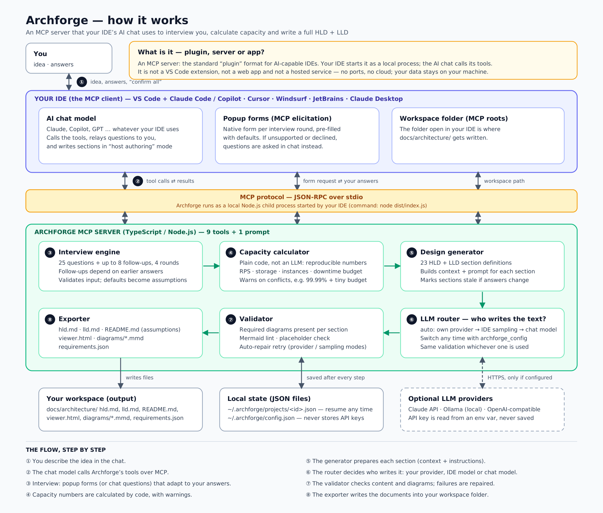
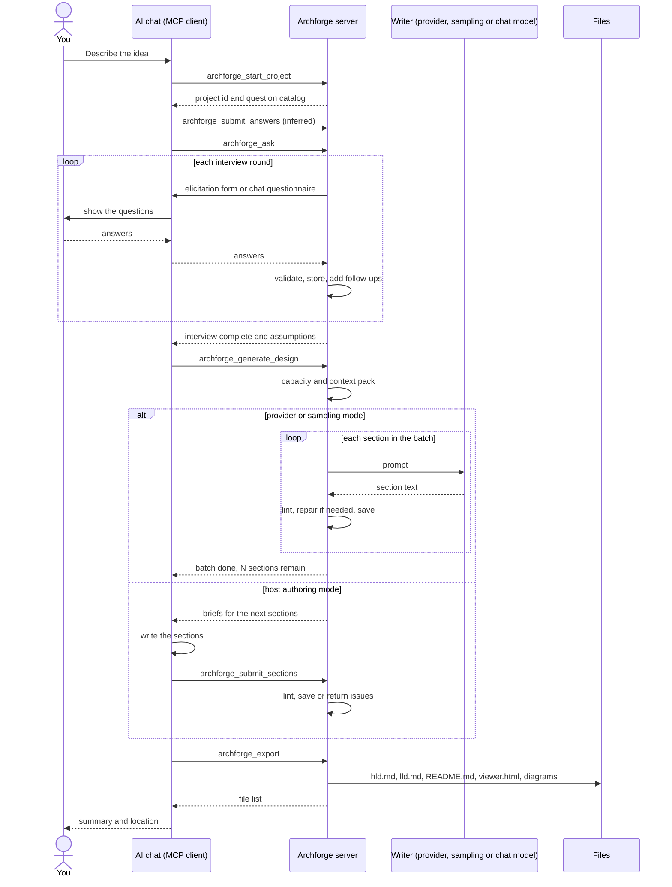
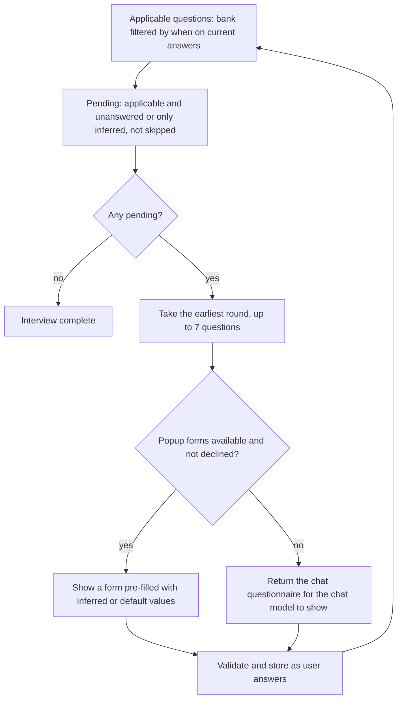
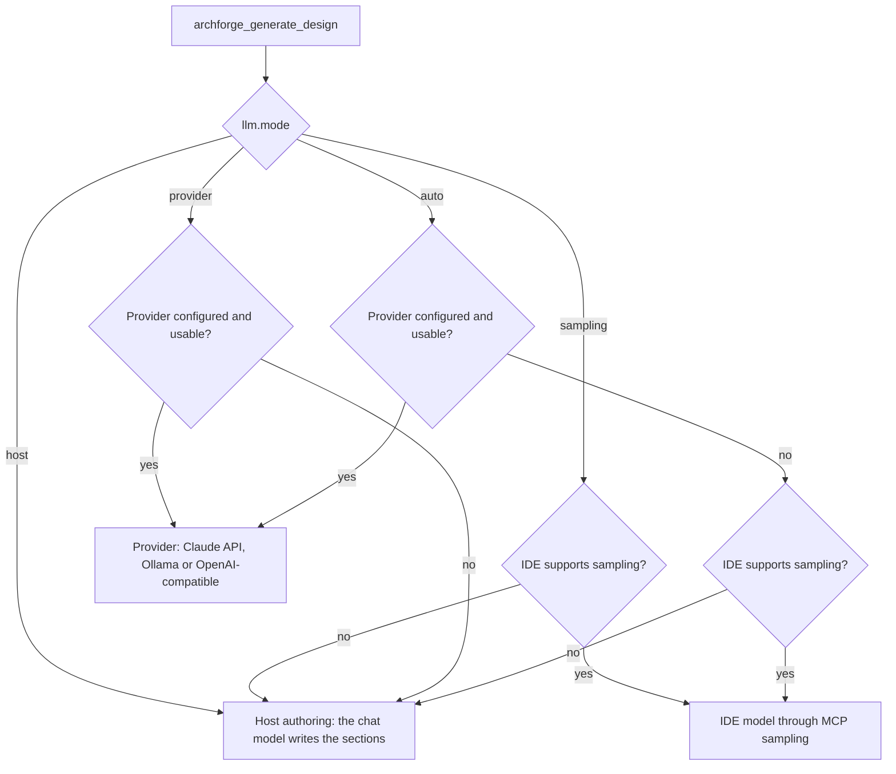
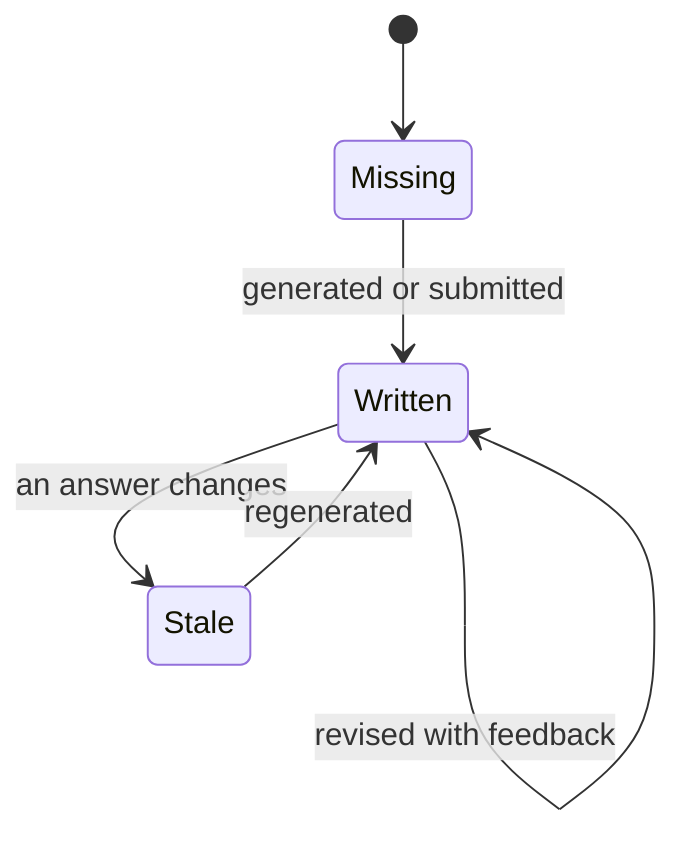

# Archforge architecture

This document explains how Archforge is built and why. For setup and day-to-day use see the [README](../README.md).



## 1. What it is

Archforge is a **Model Context Protocol (MCP) server** written in TypeScript. MCP is an open protocol that lets an AI application (the *client*, usually your IDE's chat) discover and call *tools* exposed by a separate program (the *server*).

| Aspect | Detail |
|---|---|
| Process model | The IDE starts `node dist/index.js` as a **child process** and talks to it over **stdin/stdout** (JSON-RPC 2.0). When the IDE closes the pipe, the server exits. |
| Network | No listener, no ports, no telemetry. Outbound calls only to an LLM provider **if you configured one**. |
| Surface | 9 tools and 1 prompt (`design_app`). |
| State | JSON files under `~/.archforge` (override with `ARCHFORGE_HOME`). |
| Dependencies | `@modelcontextprotocol/sdk` and `zod` at runtime; providers use Node's built-in `fetch`. |

### Design principles

1. **LLM-independent orchestration.** The server owns everything that must be reliable — questions, arithmetic, structure, validation, files — and delegates only *writing* to a model.
2. **Deterministic where possible.** Capacity numbers come from formulas, so two runs with the same answers give identical numbers.
3. **The human stays in the loop.** The chat model may *suggest* answers (marked *inferred*) but the user must confirm them; unanswered questions become visible *assumptions*.
4. **Degrade gracefully.** Every optional MCP capability (elicitation, sampling, roots) has a fallback, so the same server works in any client.
5. **Resumable and non-destructive.** State is saved after every step with atomic writes; changing an answer marks affected sections *stale* instead of silently rewriting them.
6. **No secrets at rest.** API keys are read from environment variables and never persisted.

## 2. Components

| Component | Source | Responsibility |
|---|---|---|
| CLI / entry | `src/index.ts` | `serve` (default), `config`, `print-config`, `help` |
| MCP server | `src/server.ts` | Registers tools and the prompt; orchestrates interview, generation, export; detects client capabilities |
| Question bank | `src/questions/bank.ts` | The 33 questions: type, options, defaults, `why`, follow-up conditions (`when`), parsing and validation |
| Interview engine | `src/questions/engine.ts` | Applicability, *pending* rules, batching by round, applying answers/defaults, inferred-answer confirmation |
| Capacity calculator | `src/capacity.ts` | Load, storage, compute, availability, sizing guidance, consistency warnings |
| Section catalog | `src/design/sections.ts` | The 23 sections: instructions, required diagrams, dependencies, writing rules |
| Prompt builder | `src/design/prompts.ts` | Context pack (requirements + capacity), per-section brief, retry prompt |
| Validator | `src/design/diagrams.ts` | Output cleanup, content checks, Mermaid lint, required-diagram checks |
| Exporter | `src/design/render.ts` | `hld.md`, `lld.md`, README index, `viewer.html`, `.mmd` files, `requirements.json` |
| LLM layer | `src/llm/*` | Provider clients (Anthropic, Ollama, OpenAI-compatible), MCP sampling, and the router |
| Interview UI | `src/ui/interview.ts` | Popup-form schema/parsing and the chat questionnaire formatter |
| Persistence | `src/store.ts`, `src/config.ts` | Project JSON files, settings layers |

## 3. A session end to end



## 4. The interview engine

### 4.1 Rules

* **Applicable** questions are the bank filtered by each question's `when(answers)` condition, evaluated on the answers collected *so far*. Follow-ups therefore appear as soon as the answer that triggers them exists.
* A question is **pending** if it is applicable and has no answer, **or** its answer is only *inferred*, and it was not skipped.
* **Batches** contain up to 7 pending questions from the earliest round that still has any. Rounds are *product → scale → platform → security*.
* **Answer sources**: `user` (explicit), `default` (accepted default, becomes an assumption), `inferred` (suggested by the chat model, must be confirmed).
* **Skipping** is possible only for *optional* questions (free text and the known-peak-RPS number).
* **Accept defaults** (`acceptAllDefaults` / `useDefaultsFor`) repeats until no new follow-up appears, so a single "use defaults" fully completes the interview.
* Every stored change that alters a value increments `answersVersion`, which drives stale detection (§6.4).



### 4.2 Input is parsed leniently, validated strictly

* Single choice accepts the option key **or** its label, ignoring case and punctuation.
* Multi choice accepts an array or a comma-separated string; selecting `none` together with other options drops `none`.
* Numbers accept `10k`, `1.5m`, thousands separators; min/max are enforced. For optional numbers a blank value, `null` or `0` means "not provided".
* Invalid values never enter the project; the error is returned and the question is asked again.

### 4.3 Popup forms (MCP elicitation)

Forms are flat JSON-Schema objects, the only shape every client supports:

| Question type | Form field |
|---|---|
| single | string with `enum` and display names, default pre-selected |
| multi | **one boolean per option** (array fields are not universally supported) |
| number | number with `minimum`/`maximum` |
| text | string |

Behavior: the server waits up to 30 minutes for a form; **decline** or an invalid result switches that project to chat questions (sticky `uiMode: "chat"`); **cancel** stops the interview with progress saved. `archforge_ask` with `mode: "elicit"` forces forms again.

### 4.4 Chat questionnaire (fallback)

When forms are unavailable the tool returns a structured text: numbered questions, option keys, suggested values and a short *instruction block for the chat model* (show these verbatim, never answer for the user, map replies to ids, call `archforge_submit_answers`). The chat model does the natural-language-to-structured step; the server validates the result.

## 5. Capacity model

All formulas are in `src/capacity.ts`; every constant is echoed into the generated report so it can be challenged.

| Quantity | Formula |
|---|---|
| Peak RPS | known value if provided, else `concurrent users × requests per user per minute ÷ 60` |
| **Design RPS** | `peak × growth factor (1×/2×/5×/10×) × 1.3` headroom, rounded up |
| Read / write RPS | design RPS split by the chosen read/write mix |
| Average RPS | `peak ÷ 3` (peak-to-average ratio) |
| Writes per day | `average RPS × 86,400 × write share` |
| Egress | `design RPS × response KB × 8 ÷ 1000` Mbps |
| Structured storage | `registered users × growth × MB per user ÷ 1024` GB |
| Upload storage | `registered users × growth × upload MB per user ÷ 1024` GB (if uploads) |
| Transactional storage | `writes/day × 365 × retention years × 2 KB` |
| Provisioned storage | `total × 3` (replicas, indexes, backups) |
| App instances | `ceil(design RPS ÷ (250 RPS × 60% utilization))`, minimum 3 when availability ≥ 99.9%, else 2 |
| Serverless concurrency | `design RPS × (p95 latency target ÷ 2)` when serverless is chosen |
| Realtime nodes | `ceil(connections × growth ÷ 20,000)`, minimum 2 |
| Allowed downtime | `(1 − availability) × 365 days` |

**Sizing guidance** (database tier, caching, CDN, multi-AZ/region) is chosen from thresholds on write RPS, read RPS, data size, geography and availability.

**Consistency warnings** flag combinations such as: budget under $500 with a large footprint or ≥ 99.95% availability; 99.99% with a small budget; self-managed Kubernetes with a small team; HIPAA/PCI with a sub-$500 budget; a known peak far below the estimate; more concurrent users than registered users.

## 6. Design generation

### 6.1 Sections

23 sections (12 HLD, 11 LLD), listed with dependencies and required diagrams in [SECTIONS.md](SECTIONS.md). One section (capacity) is computed; the other 22 are written by a model. Sections declare `dependsOn`, and the text of those earlier sections (truncated to 5,000 characters each) is included in the prompt so later sections stay consistent with earlier decisions.

### 6.2 What a model receives

1. **Writing rules** (the system prompt): be specific to this app, ground decisions in the numbers, justify technology choices with alternatives, state assumptions, follow Mermaid syntax rules, no placeholders, output only the section body.
2. **Context pack**: project name and idea, all gathered requirements (assumed/inferred values labelled), and the full capacity report.
3. **Section brief**: the section's instruction, the diagram requirement, dependency excerpts, and optional user feedback plus the current draft when revising.

### 6.3 Who writes: the LLM router



| Mode | Who runs the model | Batch size per call | Repair |
|---|---|---|---|
| Provider / sampling | The server sends prompts and receives text | 4 sections (`generation.sectionsPerCall`) | Automatic: up to 2 retries with the validator's complaints appended |
| Host authoring | The IDE's chat model, from briefs returned by the tool | 3 sections | The chat model fixes and resubmits rejected sections |

Calls are bounded so a tool call stays within client timeouts; the tool result tells the chat model to call again until everything is written. Progress notifications are sent when the client supplies a progress token. When a provider is unusable (for example the key variable is missing) the router falls back and says why.

### 6.4 Regeneration and stale detection

Each stored section records the `answersVersion` it was written under. If an answer later changes, those sections are reported **stale** in `archforge_status`, in exports, and in the document itself.



Regeneration options: `regenerate: "missing"` (default) writes only absent sections; `"stale"` also rewrites stale ones; `"all"` marks everything in scope stale and rewrites it; `sectionIds` + `feedback` rewrites exactly the named sections using the user's feedback and the existing draft.

## 7. Validation

Applied to every section regardless of who wrote it.

| Check | Detail |
|---|---|
| Output cleanup | Unwraps a whole-answer ```markdown fence, drops a chatty first line, shifts headings so the shallowest is H3 (the document supplies H2) |
| Minimum length | 400 characters by default (800 for data model and API sections) |
| Placeholders | Rejects `lorem ipsum`, `[insert …]`, `<placeholder>`, `TODO:` |
| Code fences | Even number of fence lines |
| Required diagrams | Each section declares required diagram types and minimum counts |
| Flowcharts | Balanced brackets per line, unquoted labels containing parentheses, `subgraph`/`end` balance, at least one edge |
| Sequence diagrams | `alt/opt/loop/par/critical/break/rect` closed by `end`, at least one message |
| ER diagrams | Relationships need a `: label`; attribute types must be one word (no `varchar(255)`); entity braces balance |
| Class / state diagrams | Brace balance |
| Any diagram | Recognised diagram type, no smart quotes, no nested fences |

This is a **heuristic lint**, deliberately conservative: it targets mistakes models make most often. It is not the Mermaid parser, so a diagram that passes can still occasionally fail to render. In provider/sampling mode, failures trigger up to two repair attempts; if issues remain the section is **kept with warnings** (shown in `archforge_status`) rather than blocking the run. In host mode a rejected submission is returned with itemised issues, and `force: true` stores it anyway for suspected false positives.

## 8. Persistence and files

```
~/.archforge/                      (override: ARCHFORGE_HOME)
├── config.json                    settings (never contains API keys)
├── projects/
│   └── <name>-<4 hex>.json        one file per project
└── exports/<project-id>/          fallback export location when the IDE exposes no workspace
```

Project file (simplified):

```json
{
  "id": "fooddash-01b7",
  "name": "FoodDash",
  "description": "the idea, in the user's words",
  "answers": { "cloud": { "value": "aws", "source": "user", "at": "…" } },
  "skipped": ["ai_usage"],
  "answersVersion": 12,
  "sections": {
    "hld.architecture": {
      "content": "markdown…",
      "generatedBy": "host | sampling | anthropic:<model> | ollama:<model> | computed",
      "answersVersion": 12,
      "warnings": ["optional lint issues that remained"]
    }
  },
  "uiMode": "chat"
}
```

Writes are atomic (temp file + rename). Project ids are restricted to `[a-z0-9-]` to prevent path traversal. Settings merge three layers — defaults → `config.json` → `ARCHFORGE_*` environment variables.

## 9. Export

`archforge_export` resolves the target folder as: explicit `outDir` → first workspace *root* reported by the client → process working directory, joined with `docs/architecture`. If the resolved base is a filesystem root or the user's home directory (typical when an IDE launches the server without a workspace), it falls back to `~/.archforge/exports/<id>` and says so. The export always renders from the stored project, so it is repeatable and safe to run at any time; missing sections are marked "not generated yet" and stale ones carry a warning.

## 10. Robustness

* Closed pipe → quiet exit instead of an `EPIPE` crash.
* Long operations use explicit timeouts: forms 30 min, sampling 10 min, Ollama 15 min, OpenAI-compatible 10 min, Claude API 5 min, roots lookup 3 s, Ollama health check 2.5 s.
* Provider errors stop the batch with a clear message, keep everything already saved, and suggest switching to host mode.
* Ollama requests set a 16k context window explicitly (its default silently truncates long prompts).
* The OpenAI-compatible client retries once with `max_completion_tokens` when a model rejects `max_tokens`.
* stdout is reserved for the protocol; all logging goes to stderr.

## 11. Security model

| Concern | Handling |
|---|---|
| Secrets | Keys come from environment variables named in config; `archforge_config` refuses to accept keys; nothing secret is written to disk |
| Network exposure | None (stdio only) |
| Data sent out | Only to the model that writes the text (IDE model, or the configured provider) |
| Local data | Plain JSON in the user's profile; protected by OS file permissions; delete to erase |
| File writes | Only inside the export folder and `~/.archforge`; ids sanitized |
| Prompt content | Generated sections are fed back into later prompts; avoid putting secrets in the idea or free-text answers |
| Third-party scripts | `viewer.html` loads `marked` and `mermaid` from a CDN when opened in a browser |

## 12. Extension points

| To add… | Do this |
|---|---|
| A question | Add an entry to `QUESTIONS` in `bank.ts` (optionally with `when`); use its answer in `capacity.ts` or rely on it appearing in the context pack; `npm run docs` |
| A document section | Add an entry to `SECTIONS` in `sections.ts` with instruction, required diagrams and `dependsOn`; it appears in exports automatically |
| An LLM provider | Implement `LlmProvider.complete()` (see `src/llm/ollama.ts`), register it in `buildProvider` in `src/llm/index.ts`, add the id to the config types |
| A lint rule | Extend `lintMermaid` / `lintSection` in `diagrams.ts` and add a case to `test/smoke.mjs` |
| A capacity rule or warning | Edit `estimateCapacity` in `capacity.ts` |

## 13. Trade-offs and why

| Decision | Rationale | Cost |
|---|---|---|
| MCP server instead of an IDE extension | One implementation works in every MCP-capable IDE; the IDE's chat provides the UI | Features depend on client MCP support — hence the fallbacks |
| Host authoring as the universal fallback | Works with no API key and no sampling support | The chat model must follow instructions; validation catches deviations |
| Deterministic capacity maths | Reproducible, auditable, cheap | Rules of thumb, not measurements |
| Heuristic Mermaid lint | No heavy browser/DOM dependency, fast | Not a guarantee of renderability |
| JSON files instead of a database | Zero setup, easy to inspect and delete | No concurrent multi-user access |
| Inferred answers require confirmation | Keeps the human in control of assumptions | One extra confirmation step |
| One tool call writes a few sections, not all | Stays within client timeouts; progress survives interruption | More round trips |
